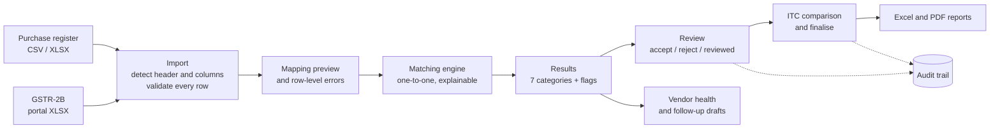

<div align="center">

# Taxora

**GST reconciliation and compliance workspace for chartered accountants and finance teams.**

Match the purchase register against GSTR-2B, explain every difference in plain language, record each review decision, and keep a full audit trail.


</div>

---

## Contents

- [Why Taxora](#why-taxora)
- [Features](#features)
- [How a reconciliation works](#how-a-reconciliation-works)
- [The matching engine](#the-matching-engine)
- [Design principles](#design-principles)
- [Tech stack](#tech-stack)
- [Getting started](#getting-started)
- [Environment variables](#environment-variables)
- [Scheduler (automations)](#scheduler-automations)
- [Testing](#testing)
- [Project structure](#project-structure)
- [Security](#security)
- [Known limitations](#known-limitations)
- [Roadmap](#roadmap)

---

## Why Taxora

Every month, an Indian business has to check that the input tax credit in its books is backed by what its suppliers reported, which shows up in **GSTR-2B**. In practice that means matching hundreds of rows by hand in Excel. The invoice numbers are written differently (`SGE/88` vs `SGE-0088`), the amounts are off by a rupee, suppliers file late, and the same bill gets entered twice.

Taxora does that matching, shows **why** each result was classified the way it was, and keeps the professional judgement with the reviewer:

- every match comes with its reasons and a score breakdown
- every difference is flagged, never silently accepted
- every decision is recorded with who made it, when, and why
- figures are presented as **evidence for review**, never as a ruling on ITC eligibility

It is built for **CA practices** handling many clients, **company finance teams** reconciling their own GSTINs, and **independent professionals**.

---

## Features

### GST reconciliation
- **Upload** the purchase register (Tally, Busy or Excel exports, CSV or `.xlsx`) and the GSTR-2B Excel download.
- **Automatic column detection**: two-row portal headers, title rows above the table, Indian number formats (`1,20,000.00`), day-first and Excel-serial dates, totals rows skipped.
- **Column mapping preview** that you can correct before anything is matched. The original file is kept, so a mapping can be re-applied without uploading again.
- **Honest import report**: every rejected row is listed with its row number, column, reason and original value (for example a GSTIN with a wrong check digit). Nothing is dropped silently.
- **Upload guards**: warnings for a file whose invoices fall in the wrong period, for GSTR-2B and purchase-register files placed in each other's slots, and for a file already used in another period's reconciliation.
- **Seven result categories**: exact, fuzzy, probable, GSTIN mismatch, missing in GSTR-2B, missing in books, duplicate.
- **Result detail**: the two sides shown together, differences per tax head, the normalised invoice numbers, the score breakdown and the original cell values as uploaded.
- **Review workflow**: accept, reject (a note is required) or mark reviewed, with full history. Search and a "needs review" filter.
- **ITC comparison and finalisation**: books vs GSTR-2B tax, split into clear buckets (matched, awaiting review, not in 2B, rejected, duplicates, excess on matched invoices, not in books). Owners and admins finalise with a note, which locks every decision.

### Reports
- **Excel**: an executive summary with the ITC comparison, one sheet per category with SUM totals, and an import-errors sheet.
- **PDF**: an A4 landscape review summary with page numbers and the finalisation stamp.
- Reports are always built from **live results** and say clearly when a filter was applied.

### Vendor health
- Matching rate per supplier across completed reconciliations, sorted worst first.
- Supplier pages list the items to raise, plus a **follow-up email draft** (one per client and month) built from the real invoices. The wording is factual and never accusatory.
- A follow-up log (draft, sent outside Taxora, resolved). **Taxora never sends emails to suppliers.**

### Compliance
- **Due-date rules that you define**, each with its source (notification or circular). Taxora ships **no built-in statutory dates**.
- Tasks are generated per client and period without duplicates, with overdue, due-soon and upcoming buckets, review notes, and an Excel export.

### Automations
- Compliance due reminders, pending-review reminders, and alerts for suppliers repeatedly missing from GSTR-2B.
- Run on a server-side scheduler or with "Run now". Every run is recorded with its status and duration, and a run never alerts the same item twice.
- Automatic retries with backoff; owners and admins are notified when an automation keeps failing.

### AI assistance (optional)
- A plain-language explanation of a single difference, and a review overview of a whole reconciliation.
- **Data-minimised**: only categories, flags, invoice numbers, dates and amounts are sent. GSTINs, supplier names and client names are never sent.
- Structured output is validated against a schema; anything invalid is discarded. Every answer is labelled *"AI suggestion — verify before relying on it"*, with the model name and time.

### Workspace
- Email-verified sign-up (OTP) for CA practices, companies or individuals, with owner, admin and member roles.
- Clients with **GSTIN checksum validation** and duplicate protection.
- In-app notifications with per-person preferences.
- An **append-only audit trail** of every action, with filters.
- Settings for matching tolerances (each run keeps the exact settings it used), profile, password and active sessions.
- Support requests with real reference numbers (`TX-000001`).

---

## How a reconciliation works



---

## The matching engine

The engine (`src/lib/recon/engine.ts`) is pure, deterministic TypeScript with no database access, so it is fully unit-tested.

| Category | Rule (defaults, adjustable in Settings) |
|---|---|
| **Exact** | Same GSTIN, document type and normalised invoice number, same date, every amount within the rounding tolerance (₹1.00 per amount) |
| **Fuzzy** | Same GSTIN, invoice numbers ≥ 85% similar, total value within 5% |
| **Probable** | Same GSTIN, different invoice number, value within 2%, dates within 7 days |
| **GSTIN mismatch** | Same invoice and value, GSTINs differ but share the same PAN |
| **Missing in GSTR-2B / in books** | No acceptable counterpart on the other side |
| **Duplicate** | The same GSTIN, document type and invoice number repeated in one file. It is set aside and never double-matched |

How it decides:
- **Normalisation**: case, separators and leading zeros are ignored, so `SGE/88` matches `SGE-0088`.
- **One-to-one**: each record is paired at most once, and the better candidate wins.
- **Ambiguity**: when two candidates are equally good, neither is paired automatically. Both are surfaced for review.
- **Credit notes** pair only with credit notes.
- **Flags** are always raised: taxable or tax differences, IGST vs CGST+SGST conflicts, date and invoice-number differences. They are flagged even when the score is 100.
- **Score** (GSTIN 40 · invoice number 30 · amount 20 · date 10) only **ranks** candidates. It never overrides a conflicting amount.
- **Money is stored as integer paise** (`BigInt` in the database), so there are no floating-point rounding errors. A 6-paise difference is reported as ₹0.06.

---

## Design principles

Taxora is built to be trusted by professionals, and these rules are enforced in the code:

1. **No fabricated data.** Every number is computed from the user's own records. Empty states are honest.
2. **No eligibility rulings.** ITC figures are comparisons for professional review. Taxora never says credit is eligible or ineligible.
3. **No invented due dates.** Every date comes from a rule or entry the workspace made, and shows its source.
4. **No pretend integrations.** Taxora does not connect to the GST portal or file returns. Email and AI show "Not configured" until keys are set.
5. **Nothing silently dropped.** Rejected rows, duplicates and ambiguous matches are always visible.
6. **Everything auditable.** Every change is written to an append-only audit log in the same transaction as the change itself.
7. **Data never reset.** Finalised reconciliations are locked; corrections go into a new run.

---

## Tech stack

| Layer | Choice |
|---|---|
| Framework | **Next.js 16** (App Router, Server Components, Server Actions, Cache Components / Partial Prerendering) |
| Language | **TypeScript** (strict) |
| Database | **PostgreSQL** on [Neon](https://neon.tech) (pooled connections for the app, direct connection for migrations) |
| ORM | **Prisma 7** with the `pg` driver adapter |
| Validation | **Zod** |
| Styling | **Tailwind CSS**, with [Lucide](https://lucide.dev) icons |
| Spreadsheets | **ExcelJS** (read and write, in memory) |
| PDF | **pdf-lib** |
| Email | **Resend** (optional) |
| AI | **Anthropic Messages API** (optional, server-side only) |
| Tests | Node's built-in test runner with **tsx** |

---

## Getting started

### Prerequisites
- **Node.js 20+** and npm
- A **PostgreSQL** database. A free [Neon](https://neon.tech) project works; pick the region closest to your users.

### 1. Clone and install
```bash
git clone https://github.com/pandeylakshya207-max/taxora.git
cd taxora
npm install
```

### 2. Configure the environment
```bash
cp .env.example .env
```
Fill in at least `DATABASE_URL` and `DIRECT_URL` (see [Environment variables](#environment-variables)).

### 3. Create the database tables
```bash
npx prisma migrate deploy
npx prisma generate
```

### 4. Run
```bash
npm run dev          # development, http://localhost:3000
# or
npm run build && npm start   # production build (much faster)
```

### 5. Try it with the sample data
`samples/` holds **synthetic** files for a test client with GSTIN `08ABCDE1234F1Z0`, for July and August 2026. The August pair covers every result category, a rejected row and a totals row. Expected results are in [`samples/README.md`](samples/README.md).

> In development, if email is not configured, the sign-up verification code is printed in the terminal (marked `[DEV ONLY]`). Production refuses to start a sign-up without real email delivery.

---

## Environment variables

| Variable | Required | Purpose |
|---|---|---|
| `DATABASE_URL` | ✅ | Pooled PostgreSQL connection used by the app (Neon host contains `-pooler`) |
| `DIRECT_URL` | ✅ | Direct (non-pooled) connection used by `prisma migrate` |
| `RESEND_API_KEY` | For production sign-ups | Sends verification codes and support-ticket copies |
| `EMAIL_FROM` | With Resend | Sender address on a verified domain |
| `SUPPORT_EMAIL` | Optional | Receives a copy of each new support ticket |
| `ANTHROPIC_API_KEY` | Optional | Turns on the AI explanations |
| `ANTHROPIC_MODEL` | Optional | Overrides the default model |
| `CRON_SECRET` | For scheduled automations | Shared secret (16+ characters) for the scheduler endpoint |

**Never commit `.env`.** It is git-ignored. Keys are read only on the server and are never sent to the browser.

---

## Scheduler (automations)

Automations never run on browser timers. An external scheduler calls the protected endpoint:

```
GET /api/cron/run
Authorization: Bearer <CRON_SECRET>
```

Call it every 15 minutes. Each call runs every enabled automation that is due, records the call, and returns `{ processed, failed, interrupted, remaining }`. Requests without the correct secret get **401**.

- **Vercel**: add a Cron Job for `/api/cron/run`. Vercel sends the `Authorization` header automatically when `CRON_SECRET` is set (plan limits on cron frequency apply).
- **Windows** (local or on-premise): a Task Scheduler job running
  ```powershell
  Invoke-RestMethod http://localhost:3000/api/cron/run -Headers @{ Authorization = "Bearer <CRON_SECRET>" }
  ```

The Automations page shows the time of the last scheduler call, so you can see at a glance whether it is running.

---

## Testing

```bash
npm test          # 68 tests
npx tsc --noEmit  # type check
```

The tests cover:
- **Matching engine**: every category, tolerances, one-to-one matching, ambiguity, credit notes, tax-type conflicts, and a 5,000 × 5,000 scale run
- **Import**: header detection, two-row portal headers, Indian amounts and dates, row-level errors, the totals row, swapped-file and wrong-period detection
- **CSV parsing**: quotes, delimiters, malformed files
- **ITC comparison and reports**: bucket totals reconcile to both sources; PDF pagination and character safety
- **Vendors**: matching-rate rules and follow-up drafts that make no claims about the supplier
- **Compliance and automations**: IST date maths, due-date rules, scheduling, retries and alert de-duplication
- **AI**: no GSTIN or name reaches a prompt; invalid model output is discarded

---

## Project structure

```
prisma/
  schema.prisma            data model (money in paise, append-only audit log)
  migrations/              versioned SQL migrations
samples/                   synthetic GSTR-2B and purchase-register files + expected results
scripts/                   database utilities (latency check, region move)
src/
  app/
    (app)/                 signed-in pages: dashboard, clients, reconciliation,
                           vendors, compliance, reports, automations, audit,
                           settings, support, notifications
    api/                   uploads, report exports, scheduler, notification count
    login/  verify/        sign-up, sign-in, email OTP
  components/              UI building blocks
  lib/
    recon/                 import, CSV, normalisation, matching engine, runs
    reports/               report data, ITC comparison, Excel and PDF builders
    vendors/               supplier statistics and follow-up drafts
    compliance/            IST dates, rules, tasks, export
    automations/           definitions, scheduling, selection logic, runner
    ai/                    prompts, schemas, API client, actions
    auth/                  passwords, sessions, OTP
tests/                     unit tests (node:test + tsx)
```

---

## Security

- **Tenant isolation is enforced on the server.** Every query is scoped to the signed-in workspace, and a second account cannot open another workspace's pages, results, exports, supplier pages or tickets, even with the exact URL (it gets a 404).
- Passwords are hashed with **scrypt**. Sessions are server-side, and only a SHA-256 hash of the cookie token is stored.
- Email OTPs are hashed, expire after 10 minutes, allow 5 attempts and have a 60-second resend cooldown.
- Role checks for finalising, matching rules, workspace settings and automations (owner and admin).
- Server-side guards for every state change, for example no review changes after finalisation and no "reject" on unpaired items.
- Secrets live only in the server environment, and the scheduler endpoint compares its secret in constant time.

---

## Known limitations

- Only the **B2B sheet** of GSTR-2B is reconciled. Credit and debit notes in **B2B-CDNR** are not imported yet.
- One sheet per uploaded file.
- No GST portal connection or return filing. This is by design.
- In-app notifications only; there are no notification emails yet.
- The AI features need an Anthropic API key.

---

## Roadmap

- [ ] GSTR-2B B2B-CDNR (credit and debit notes) import
- [ ] Team invitations and member management
- [ ] Email notifications for automations
- [ ] Bulk review actions
- [ ] Deployment guide (Vercel + Neon) and a hosted demo

---

<div align="center">
<sub>© Taxora. This is a private repository; no open-source licence has been granted.</sub>
</div>
